# Как поднять личный VPN на Remnawave

Remnawave 3.4, VLESS + REALITY, один сервер, установка скриптом или вручную. Ноябрь 2026.

PDF-версия: [remnawave-mini-guide.pdf](remnawave-mini-guide.pdf). Скрипт установки: [install.sh](install.sh).

Здесь описано, как поднять личный VPN на панели [Remnawave](https://docs.rw) с протоколом VLESS и маскировкой REALITY. Поставить его можно двумя способами. Скрипт сделает всё сам и в конце покажет ссылку и QR-код для приложения. При ручной установке вы пройдёте те же шаги в панели сами и увидите, что где настроено. Результат одинаковый. В обоих случаях нужно купить сервер и домен и создать две записи в DNS. На всё уходит около часа, и большую часть этого времени вы просто ждёте.

Команды рассчитаны на Remnawave 3.4 (панель 3.4.11, нода 3.4.6). Скрипт и блоки команд заканчивают работу строкой «ГОТОВО». Если вместо неё написано «СТОП», прочитайте сообщение, исправьте причину и запустите то же самое ещё раз. Повторный запуск ничего не ломает, потому что готовые шаги пропускаются.

**Содержание**

- [1. Как это устроено](#1-как-это-устроено)
  - [Какие бывают ключи](#какие-бывают-ключи)
- [2. Что понадобится](#2-что-понадобится)
  - [Сервер](#сервер)
  - [Домен](#домен)
  - [Приложение](#приложение)
- [3. Записи в DNS](#3-записи-в-dns)
- [4. Подключение к серверу](#4-подключение-к-серверу)
  - [Вход по ключу (по желанию, до установки)](#вход-по-ключу-по-желанию-до-установки)
- [5. Установка скриптом](#5-установка-скриптом)
- [6. Установка вручную](#6-установка-вручную)
  - [6.1. Подготовка сервера и панели](#61-подготовка-сервера-и-панели)
  - [6.2. Регистрация в панели](#62-регистрация-в-панели)
  - [6.3. Профиль и ключи REALITY](#63-профиль-и-ключи-reality)
  - [6.4. Нода в панели](#64-нода-в-панели)
  - [6.5. Запуск ноды](#65-запуск-ноды)
  - [6.6. Хосты](#66-хосты)
  - [6.7. Сквад](#67-сквад)
  - [6.8. Пользователь](#68-пользователь)
- [7. Подключение](#7-подключение)
  - [7.1. Где взять ссылку](#71-где-взять-ссылку)
  - [7.2. Телефон](#72-телефон)
  - [7.3. Компьютер](#73-компьютер)
  - [7.4. Проверка](#74-проверка)
- [8. Ещё пользователи](#8-ещё-пользователи)
- [9. Панель](#9-панель)
- [10. Если не работает](#10-если-не-работает)
- [11. Полезное](#11-полезное)
  - [11.1. Российские сайты](#111-российские-сайты)
  - [11.2. Обновления](#112-обновления)
- [12. Примеры конфигов](#12-примеры-конфигов)
  - [12.1. Профиль ноды](#121-профиль-ноды)
  - [12.2. Настройки запасного подключения](#122-настройки-запасного-подключения)
  - [12.3. Нода](#123-нода)
  - [12.4. Caddy](#124-caddy)
  - [12.5. Что внутри подписки](#125-что-внутри-подписки)
- [13. Ссылки](#13-ссылки)
- [14. Текст скрипта install.sh](#14-текст-скрипта-installsh)

## 1. Как это устроено

На сервере работают две программы. Панель Remnawave нужна, чтобы создавать пользователей и выдавать им ссылки для подключения. Через ноду идёт сам трафик. Ссылку, которую вставляют в приложение, называют подпиской. По ней приложение получает настройки и потом само их обновляет.

REALITY отвечает за маскировку. Со стороны подключение к серверу выглядит как заход на обычный сайт с нормальным сертификатом.

```text
Телефон или компьютер (Happ или INCY)
  └─ VLESS + REALITY ──> сервер (нода) ──> интернет
Панель стоит на том же сервере, управляет нодой и выдаёт подписку
```

### Какие бывают ключи

В инструкциях про VPN ключом называют разные вещи. Руками вам понадобится только ссылка подписки, а остальное создаётся само или делается один раз.

| Что | Как выглядит | Где взять | Куда вставлять |
|---|---|---|---|
| Ссылка подписки, она же ключ для приложения | https://adm-xxxx.example.com/api/sub/AbCd1234EfGh5678 | скрипт показывает её в конце работы, а при ручной установке её выдаёт панель в разделе «Пользователи» | в Happ или INCY (раздел 7) |
| Ключи REALITY (приватный ключ и shortId) | приватный ключ из 43 символов, shortId из 16 цифр и букв | создаются сами, а руками их можно сделать по разделу 6.3 | в профиль ноды в панели, а в приложение их вставлять не нужно |
| Ключ ноды SECRET\_KEY | строка в несколько тысяч символов | в панели, кнопка «Скопировать docker-compose.yml» в окне создания ноды | в файл настроек ноды на сервере (раздел 6.5). Скрипт делает это сам |
| SSH-ключ | файл id\_ed25519 на вашем компьютере | команда ssh-keygen на вашем компьютере | на сервер (раздел 4). Он не обязателен, можно входить и по паролю |
| Логин и пароль панели | любой логин и пароль от 24 символов | скрипт придумывает их сам и показывает в конце, а при ручной установке их придумываете вы | в форму входа в панель |

## 2. Что понадобится

### Сервер

Нужен сервер с Ubuntu 24.04. Хватит 2 ядер (vCPU), 2 ГБ памяти (лучше 4 ГБ), 20 ГБ диска и канала от 1 Гбит/с. Для личного VPN это с запасом. Панели управления и дополнительный софт при заказе не выбирайте. После оплаты хостер пришлёт на почту IP-адрес сервера и пароль пользователя root.

| Хостер | Страны | Оплата | Особенности |
|---|---|---|---|
| [Netcup](https://www.netcup.com) | Германия, Австрия, Нидерланды, США | карта, PayPal | много памяти и диска за небольшие деньги |
| [Hetzner](https://www.hetzner.com/cloud) | Германия, Финляндия, США, Сингапур | карта, PayPal | недорогие и быстрые серверы, при регистрации могут попросить фото документа |
| [DigitalOcean](https://www.digitalocean.com) | США, Канада, Европа, Азия | карта, PayPal | самый простой интерфейс, сервер создаётся за минуту |
| [Cherry Servers](https://www.cherryservers.com) | Литва, Нидерланды, Германия, Швеция | криптовалюта, карта, PayPal | своя сеть, её нет в списках блокировок |
| [V.PS](https://v.ps) | Эстония, Германия, Нидерланды, Великобритания | криптовалюта, карта, PayPal | своя сеть, её нет в списках блокировок |

Сам я держу серверы на Netcup. Там недорого, а памяти и диска с запасом. Учтите одну вещь. Российские фильтры иногда на несколько минут блокируют всю сеть хостера, если поймали в ней VPN. Чаще всего так бывает с крупными хостерами вроде Netcup, Hetzner и DigitalOcean. VPN на них работает, но временами может пропадать. Если это мешает, пересоздайте сервер в другой стране или возьмите Cherry Servers или V.PS. Aeza не берите, потому что компания под санкциями и сама блокирует VPN.

Российские карты за границей не принимают, поэтому платить придётся криптовалютой, зарубежной картой или через PayPal. Сначала возьмите сервер на месяц и проверьте, как VPN работает с домашнего интернета и с мобильного.

### Домен

Домен можно купить у любого зарубежного регистратора, например у [NameSilo](https://www.namesilo.com). Зоны .ru, .su и .рф не берите. Записи DNS можно править прямо у регистратора или перенести домен в бесплатный [Cloudflare](https://www.cloudflare.com).

### Приложение

Для любых устройств берите [Happ](https://happ.info/) или [INCY](https://incy.cc/#downloads). Оба есть для iOS, Android, Windows, macOS, Linux и телевизоров.

## 3. Записи в DNS

В личном кабинете регистратора (или Cloudflare) откройте управление DNS вашего домена. Раздел обычно называется «DNS», «DNS Records» или «Manage DNS». Создайте две записи типа A с IP вашего сервера. В поле «Имя» (Name или Host) пишется левая часть адреса, в поле «Значение» (Value, IPv4 address или Points to) пишется IP сервера.

| Имя | Значение | Для чего |
|---|---|---|
| adm-xxxx | IP сервера | адрес панели и подписок |
| n1 | IP сервера | адрес ноды |

Вместо xxxx придумайте случайный набор букв и цифр, чтобы адрес панели нельзя было угадать. Если DNS в Cloudflare, значок облака у записей должен быть серым (DNS only).

Записи начинают работать через 5–30 минут. Скрипт и блок ручной установки сами проверят, что они уже указывают на сервер, и остановятся, если нет.

## 4. Подключение к серверу

Понадобится терминал. На Windows 10 и 11 нажмите «Пуск» и начните набирать «Терминал» (подойдёт и PowerShell). На macOS нажмите Cmd+Пробел и наберите «Терминал». Подключитесь к серверу командой ниже. Вместо SERVER\_IP подставьте IP из письма хостера.

```bash
# у себя на компьютере, Windows и macOS одинаково
ssh root@SERVER_IP
```

При первом подключении появится вопрос «Are you sure you want to continue connecting (yes/no/\[fingerprint\])?». Так компьютер спрашивает, доверять ли серверу, который видит впервые. Напечатайте yes и нажмите Enter, потом введите пароль из письма. Символы пароля при вводе не видны. Так и должно быть. Если всё получилось, строка ввода сменится на что-то вроде `root@имя-сервера:~#`.

Текст в терминал вставляется в Windows Terminal клавишами Ctrl+V или правой кнопкой мыши, в macOS клавишами Cmd+V.

### Вход по ключу (по желанию, до установки)

С ключом вход по паролю на сервере отключится, и подобрать пароль будет нельзя. Если хотите так, сделайте это до установки. Скрипт и блок ручной установки сами выключат вход по паролю, когда увидят ключ. Ключ создаётся на вашем компьютере один раз. На все вопросы программы можно нажимать Enter. Если она спросит «Overwrite (y/n)?», значит ключ у вас уже есть, ответьте n.

```bash
# у себя на компьютере, Windows и macOS одинаково
ssh-keygen -t ed25519
```

Затем отправьте ключ на сервер. Команда попросит пароль от root.

```powershell
# Windows, в PowerShell или Терминале на своём компьютере
type $env:USERPROFILE\.ssh\id_ed25519.pub | ssh root@SERVER_IP "mkdir -p ~/.ssh && cat >> ~/.ssh/authorized_keys && chmod 600 ~/.ssh/authorized_keys"
```

```bash
# macOS, в Терминале на своём компьютере
ssh-copy-id root@SERVER_IP
```

Если когда-нибудь не получится зайти на сервер, в личном кабинете хостера есть веб-консоль (VNC, KVM или просто «Консоль»). Через неё можно войти с паролем root.

## 5. Установка скриптом

Скрипт install.sh лежит рядом с этим гайдом, а его полный текст есть в конце, в разделе 14. Сначала создайте его на сервере. Команда ниже откроет пустой файл в редакторе nano.

```bash
# на сервере
nano install.sh
```

Скопируйте весь текст скрипта (в HTML-версии гайда над ним есть кнопка «Копировать») и вставьте в nano. В Windows Terminal это правая кнопка мыши или Ctrl+V, в macOS Cmd+V. Чтобы сохранить файл и выйти, нажмите Ctrl+O, потом Enter, потом Ctrl+X. Теперь запустите скрипт.

```bash
# на сервере
bash install.sh
```

Сначала скрипт спросит адрес панели (например adm-k3x9.example.com), потом адрес ноды (например n1.example.com). Дальше он всё сделает сам за 5–10 минут. Обновит систему и поставит Docker, защиту от подбора пароля и ускорение TCP. Поставит панель Remnawave и Caddy, который получит HTTPS-сертификаты, и включит фаервол. Потом создаст администратора панели, ключи REALITY и профиль ноды, запустит ноду, сделает подключения «Основной» и «Запасной» и пользователя myvpn.

В конце на экране появятся адрес панели, логин и пароль администратора, ссылка подписки и QR-код. Всё это скрипт сохранит в файл /root/remnawave-vpn.txt. Посмотреть его можно командой `cat /root/remnawave-vpn.txt`. Если закрыли терминал, ссылку и QR-код можно показать снова.

```bash
# на сервере
bash install.sh info
```

## 6. Установка вручную

Этот вариант даёт тот же результат, что и скрипт, но шаги в панели вы проходите сами. Он пригодится, если хотите понимать, что где настроено. Если уже запускали скрипт, этот раздел пропустите.

### 6.1. Подготовка сервера и панели

Блок ниже обновит систему, поставит Docker, панель Remnawave и Caddy, настроит фаервол и сайт-прикрытие и создаст ключи для ноды. Перед вставкой впишите в первые две строки свои домены. Удобнее всего сначала вставить блок в Блокнот, поправить там домены и уже потом скопировать в терминал. Блок работает 5–10 минут и заканчивается строкой «ГОТОВО». Если вместо неё написано «СТОП», исправьте причину и вставьте блок ещё раз.

```bash
# на сервере, сначала впишите свои домены в первые две строки
PANEL_DOMAIN=adm-xxxx.example.com
NODE_DOMAIN=n1.example.com
(
set -eo pipefail
case "$PANEL_DOMAIN" in adm-xxxx.*|*.example.com|"") echo "СТОП: впишите домен панели в первую строку"; exit 1;; esac
case "$NODE_DOMAIN" in *.example.com|"") echo "СТОП: впишите домен ноды во вторую строку"; exit 1;; esac
for d in "$PANEL_DOMAIN" "$NODE_DOMAIN"; do
  ip=$(getent ahostsv4 "$d" | awk 'NR==1{print $1}') || true
  if [ -z "$ip" ] || ! hostname -I | grep -qw "$ip"; then
    echo "СТОП: $d пока не указывает на этот сервер (сейчас ${ip:-записи нет}). Проверьте A-запись и повторите минут через 10"
    exit 1
  fi
done

# система, защита от подбора пароля, Docker
export DEBIAN_FRONTEND=noninteractive NEEDRESTART_MODE=a
apt-get update
apt-get -y -o Dpkg::Options::=--force-confdef -o Dpkg::Options::=--force-confold upgrade
apt-get -y install curl openssl ufw fail2ban
if [ -s /root/.ssh/authorized_keys ]; then
  cat > /etc/ssh/sshd_config.d/00-hardening.conf <<'EOF'
PasswordAuthentication no
KbdInteractiveAuthentication no
PermitRootLogin prohibit-password
EOF
  sshd -t
  systemctl reload ssh
fi
cat > /etc/fail2ban/jail.local <<'EOF'
[sshd]
enabled = true
backend = systemd
maxretry = 5
findtime = 10m
bantime = 1h
EOF
systemctl enable fail2ban
systemctl restart fail2ban
mkdir -p /etc/docker
echo '{"log-driver":"json-file","log-opts":{"max-size":"50m","max-file":"3"}}' > /etc/docker/daemon.json
command -v docker >/dev/null || curl -fsSL https://get.docker.com | sh

# BBR и буферы TCP, чтобы скорость меньше проседала
echo tcp_bbr > /etc/modules-load.d/bbr.conf
modprobe tcp_bbr
cat > /etc/sysctl.d/99-zz-vpn.conf <<'EOF'
net.core.default_qdisc = fq
net.ipv4.tcp_congestion_control = bbr
net.ipv4.tcp_mtu_probing = 1
net.core.rmem_max = 67108864
net.core.wmem_max = 67108864
net.ipv4.tcp_rmem = 4096 131072 67108864
net.ipv4.tcp_wmem = 4096 16384 67108864
net.ipv4.tcp_slow_start_after_idle = 0
net.ipv4.tcp_notsent_lowat = 16384
EOF
sysctl --system >/dev/null
timedatectl set-ntp true || true

# панель Remnawave, ключи и пароль базы делаются только в первый раз
mkdir -p /opt/remnawave/caddy
cd /opt/remnawave
curl -fsSL -o docker-compose.yml https://raw.githubusercontent.com/remnawave/backend/refs/heads/main/docker-compose-prod.yml
if [ ! -f .env ]; then
  curl -fsSL -o .env https://raw.githubusercontent.com/remnawave/backend/refs/heads/main/.env.sample
  sed -i "s/^APP_SECRET=.*/APP_SECRET=$(openssl rand -hex 64)/" .env
  sed -i "s/^METRICS_PASS=.*/METRICS_PASS=$(openssl rand -hex 64)/" .env
  sed -i "s/^WEBHOOK_SECRET_HEADER=.*/WEBHOOK_SECRET_HEADER=$(openssl rand -hex 32)/" .env
  pw=$(openssl rand -hex 24)
  sed -i "s/^POSTGRES_PASSWORD=.*/POSTGRES_PASSWORD=$pw/" .env
  sed -i "s|^\(DATABASE_URL=\"postgresql://postgres:\)[^\@]*\(@.*\)|\1$pw\2|" .env
fi
sed -i "s|^PANEL_DOMAIN=.*|PANEL_DOMAIN=$PANEL_DOMAIN|; s|^FRONT_END_DOMAIN=.*|FRONT_END_DOMAIN=$PANEL_DOMAIN|; s|^SUB_PUBLIC_DOMAIN=.*|SUB_PUBLIC_DOMAIN=$PANEL_DOMAIN/api/sub|" .env
sed -i 's|image: remnawave/backend:.*|image: remnawave/backend:3.4.11|' docker-compose.yml

# Caddy выдаёт HTTPS панели и показывает заглушку на домене ноды
cat > caddy/Caddyfile <<EOF
https://$PANEL_DOMAIN {
    encode
    reverse_proxy * http://remnawave:3000
}
https://$NODE_DOMAIN {
    header Content-Type "text/html; charset=utf-8"
    respond "<html><head><title>Welcome</title></head><body><h1>Welcome</h1></body></html>" 200
}
:443 {
    tls internal
    respond 204
}
EOF
# пока ноды нет, Caddy сидит на 443, потом переедет на 127.0.0.1:8443
if [ -f /opt/remnanode/docker-compose.yml ]; then caddy_https=127.0.0.1:8443; else caddy_https=0.0.0.0:443; fi
cat > caddy/docker-compose.yml <<EOF
services:
  caddy:
    image: caddy:2.9
    container_name: caddy
    hostname: caddy
    restart: always
    ports:
      - '$caddy_https:443'
      - '0.0.0.0:80:80'
    networks:
      - remnawave-network
    volumes:
      - ./Caddyfile:/etc/caddy/Caddyfile
      - caddy-ssl-data:/data
networks:
  remnawave-network:
    name: remnawave-network
    external: true
volumes:
  caddy-ssl-data:
    name: caddy-ssl-data
EOF

# фаервол, 2222 открыт только для панели из сети Docker
ufw allow 22/tcp
ufw allow 80/tcp
ufw allow 443/tcp
ufw allow 8444/tcp
ufw allow from 172.16.0.0/12 to any port 2222 proto tcp
ufw --force enable

docker compose up -d
(cd caddy && docker compose up -d)

# ключи REALITY и готовый профиль для панели, делаются один раз
if [ ! -f /root/remnawave-profile.json ]; then
  keys=$(docker run --rm ghcr.io/xtls/xray-core x25519)
  priv=$(echo "$keys" | awk -F': ' 'tolower($1) ~ /private/ {print $2}')
  if [ -z "$priv" ]; then echo "СТОП: не получилось создать ключ"; exit 1; fi
  sid=$(openssl rand -hex 8)
  xpath=/$(openssl rand -hex 6)
  umask 077
  cat > /root/remnawave-profile.json <<EOF
{
  "log": { "loglevel": "warning" },
  "inbounds": [
    {
      "tag": "VLESS_TCP",
      "port": 443,
      "listen": "0.0.0.0",
      "protocol": "vless",
      "settings": { "clients": [], "decryption": "none", "flow": "xtls-rprx-vision" },
      "sniffing": { "enabled": true, "routeOnly": true, "destOverride": ["http", "tls", "quic"] },
      "streamSettings": {
        "network": "raw",
        "security": "reality",
        "realitySettings": {
          "show": false,
          "xver": 0,
          "target": "127.0.0.1:8443",
          "serverNames": ["$NODE_DOMAIN"],
          "privateKey": "$priv",
          "shortIds": ["$sid"]
        }
      }
    },
    {
      "tag": "VLESS_XHTTP",
      "port": 8444,
      "listen": "0.0.0.0",
      "protocol": "vless",
      "settings": { "clients": [], "decryption": "none" },
      "sniffing": { "enabled": true, "routeOnly": true, "destOverride": ["http", "tls", "quic"] },
      "streamSettings": {
        "network": "xhttp",
        "xhttpSettings": { "host": "$NODE_DOMAIN", "path": "$xpath", "mode": "stream-one" },
        "security": "reality",
        "realitySettings": {
          "show": false,
          "xver": 0,
          "target": "127.0.0.1:8443",
          "serverNames": ["$NODE_DOMAIN"],
          "privateKey": "$priv",
          "shortIds": ["$sid"]
        }
      }
    }
  ],
  "outbounds": [
    { "tag": "DIRECT", "protocol": "freedom" },
    { "tag": "BLOCK", "protocol": "blackhole" }
  ],
  "routing": {
    "rules": [
      { "ip": ["geoip:private"], "outboundTag": "BLOCK" },
      { "domain": ["geosite:private"], "outboundTag": "BLOCK" },
      { "protocol": ["bittorrent"], "outboundTag": "BLOCK" },
      { "network": "tcp", "port": "25,465,587", "outboundTag": "BLOCK" }
    ]
  }
}
EOF
  docker rmi ghcr.io/xtls/xray-core >/dev/null 2>&1 || true
fi

sleep 20
docker ps --format '{{.Names}}: {{.Status}}'
echo "ГОТОВО, откройте в браузере https://$PANEL_DOMAIN"
)
```

Перед строкой «ГОТОВО» будет список контейнеров remnawave, remnawave-db, remnawave-redis и caddy. Если у первых трёх написано `health: starting`, подождите минуту и проверьте ещё раз командой `docker ps`.

### 6.2. Регистрация в панели

Откройте в браузере адрес панели, например https://adm-xxxx.example.com. Первый зарегистрированный пользователь становится администратором, поэтому сделайте это сразу. Юзернейм придумайте любой латиницей. Пароль нужен длинный, не короче 24 символов, потому что адрес панели можно найти в открытых журналах сертификатов. Проще всего нажать «Сгенерировать и скопировать» (1), тогда панель сама придумает пароль и положит его в буфер обмена. Сохраните его у себя и нажмите «Зарегистрироваться» (2).

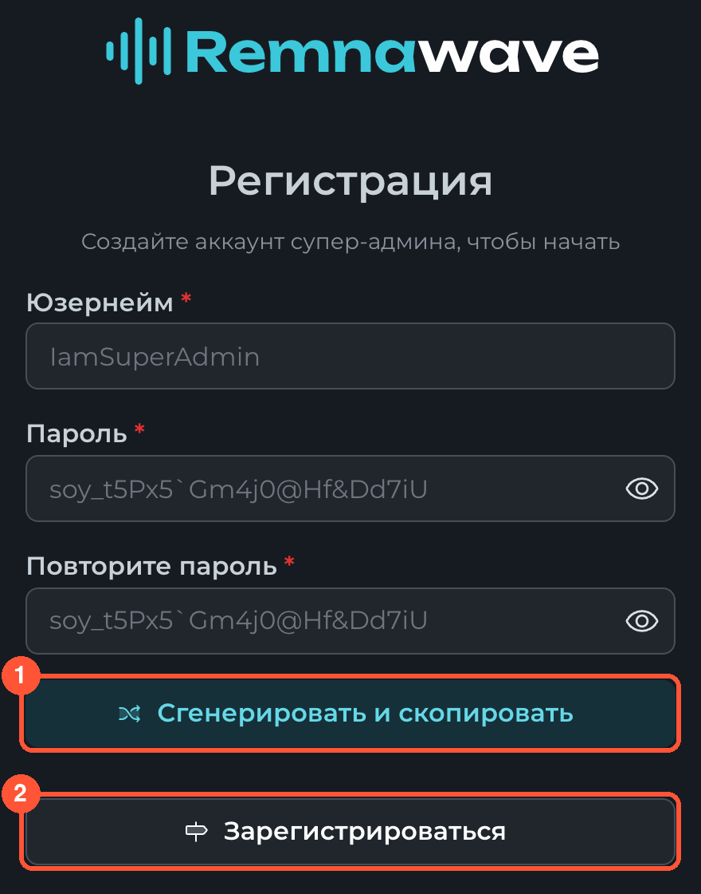

*Форма регистрации в панели*

Сразу после входа панель покажет предупреждение об ответственности. Нажмите «Понимаю и принимаю».

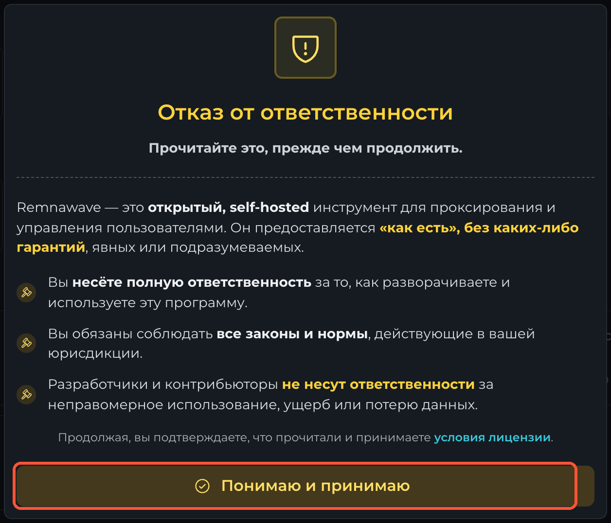

*Предупреждение после первого входа*

### 6.3. Профиль и ключи REALITY

Для маскировки REALITY нужны приватный ключ и shortId. Блок из 6.1 уже создал их и вписал в готовый профиль /root/remnawave-profile.json. Публичный ключ панель посчитает сама и передаст приложению в подписке, так что его никуда вставлять не нужно.

1. Выведите профиль на экран.

```bash
# на сервере
cat /root/remnawave-profile.json
```

2. Выделите мышью весь текст от первой фигурной скобки { до последней } и скопируйте. В Windows Terminal это Ctrl+C, в macOS Cmd+C.
3. В панели откройте раздел «Профили» в верхнем меню и нажмите зелёную кнопку «+» справа.

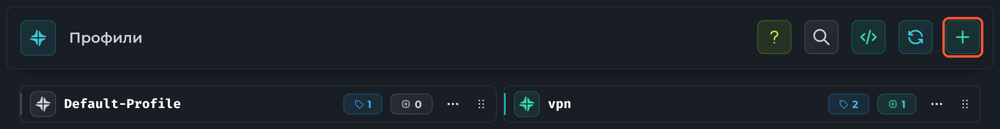

*Раздел «Профили» и кнопка создания профиля*

4. Впишите название vpn (1) и нажмите «Создать» (2).

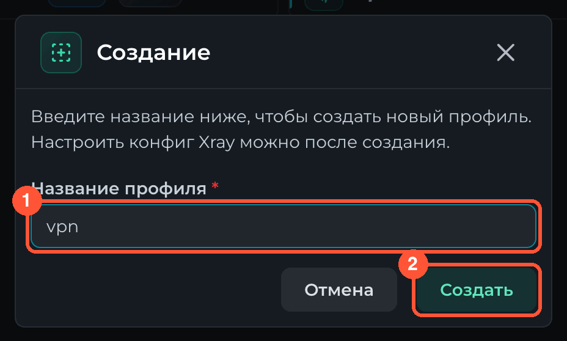

*Окно создания профиля*

5. Откроется редактор с примером настроек. Щёлкните в него мышью, нажмите Ctrl+A (на macOS Cmd+A), затем Delete, чтобы удалить пример.
6. Вставьте скопированный профиль (Ctrl+V или Cmd+V) и нажмите «Сохранить» под редактором. Строка над кнопками должна сообщить Xray config is valid.

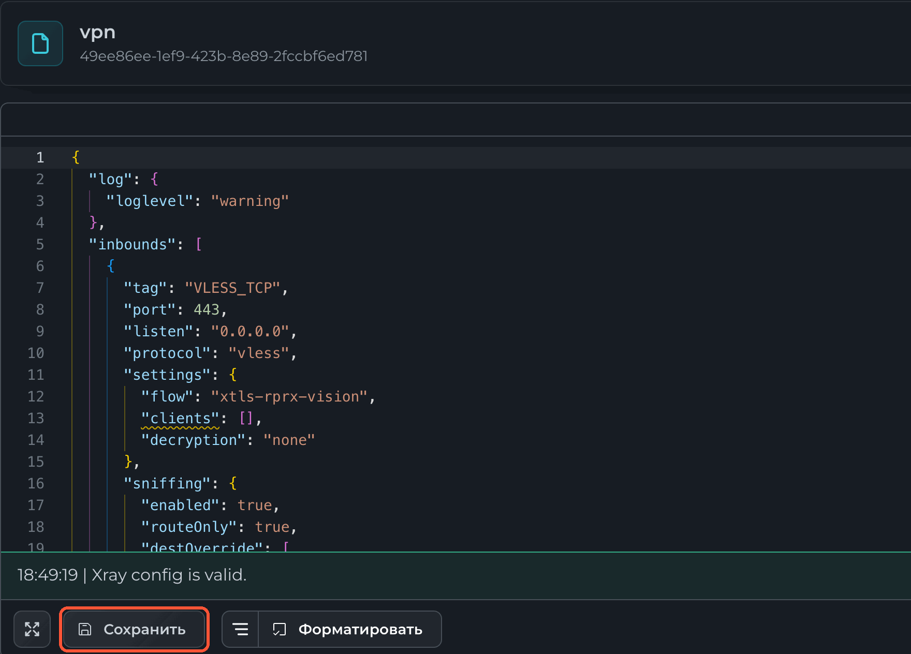

*Редактор профиля с вставленным текстом*

7. В списке профилей у vpn появится значок с цифрой 2. Это инбаунды VLESS\_TCP и VLESS\_XHTTP.

Ключи можно сделать и самому, двумя командами на сервере.

```bash
# на сервере, первая команда даёт приватный ключ, вторая shortId
docker run --rm ghcr.io/xtls/xray-core x25519
openssl rand -hex 8
```

Первая команда выведет три строки. Нужна строка PrivateKey. Приватный ключ в ней стоит после двоеточия и пробела и состоит из 43 символов (буквы, цифры, знаки - и \_). Строка Password (PublicKey) с публичным ключом не нужна. Вторая команда выведет shortId из 16 символов. Замените ими значения в профиле. Каждое встречается дважды, по разу на инбаунд. Кавычки оставьте.

```json
"privateKey": "ВАШ_ПРИВАТНЫЙ_КЛЮЧ",
"shortIds": ["ВАШ_SHORT_ID"]
```

Приватный ключ никому не показывайте. С ним можно выдать себя за ваш сервер.

### 6.4. Нода в панели

Откройте «Ноды → Ноды» в верхнем меню и нажмите зелёную кнопку «+» справа. Окно «Создать ноду» состоит из трёх шагов.

На первом шаге впишите внутреннее название, например node-1 (1), и IP вашего сервера в поле «Домен или IP» (2). Node Port оставьте 2222, страну выбирать не обязательно. Нажмите «Далее» (3).

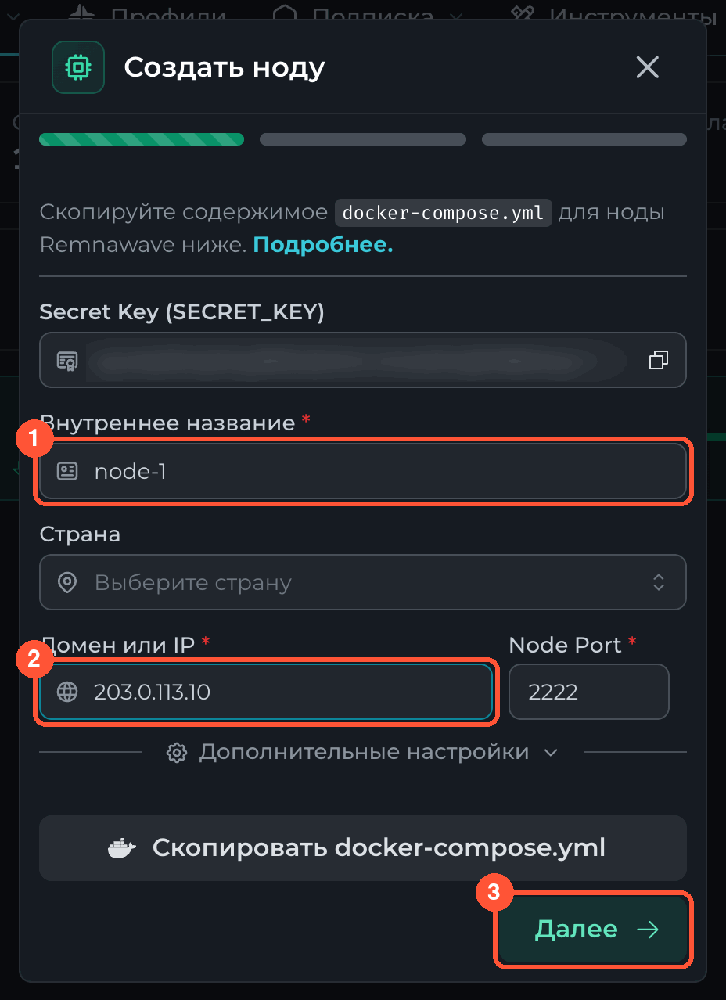

*Первый шаг. Ключ SECRET\_KEY на снимке размыт*

На втором шаге нажмите «Выбрать». Справа откроется список профилей. Нажмите галочку в строке vpn (1), чтобы отметить оба инбаунда, и сохраните выбор кнопкой с дискетой (2).

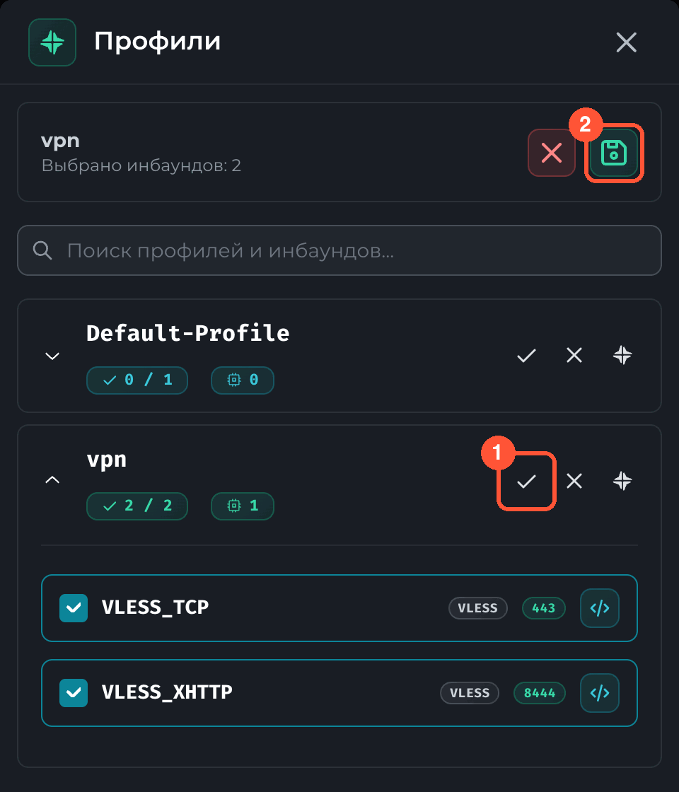

*Выбор профиля для ноды*

Теперь нажмите «Скопировать docker-compose.yml» (1), и настройки ноды окажутся в буфере обмена. Среди них есть SECRET\_KEY, строка в несколько тысяч символов. По этому ключу панель узнаёт свою ноду. Менять в скопированном тексте ничего не нужно, на следующем шаге его целиком вставляют на сервер. После этого нажмите «Создать ноду» (2).

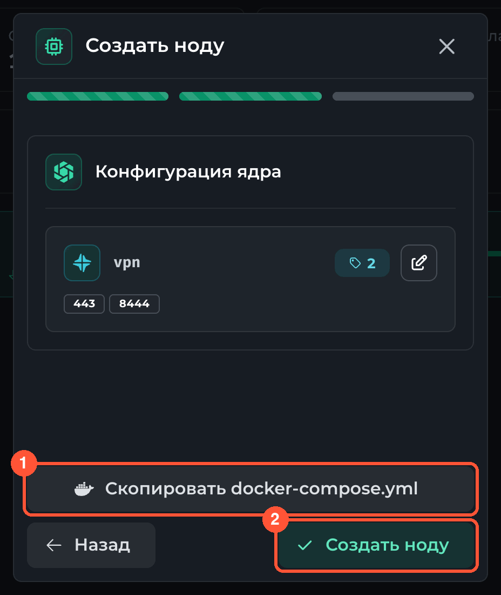

*Второй шаг. Сначала копируете настройки, потом создаёте ноду*

Окно перейдёт к третьему шагу и будет ждать, пока нода запустится. Не закрывайте его и переходите к терминалу. Если до вставки на сервер вы успели скопировать что-то другое, откройте «Создать ноду» ещё раз, нажмите «Скопировать docker-compose.yml» и закройте окно. Ключ у панели один на все ноды, поэтому такая копия тоже подойдёт.

### 6.5. Запуск ноды

Сохраните скопированные настройки на сервере. Команда ниже откроет пустой файл в редакторе nano.

```bash
# на сервере
mkdir -p /opt/remnanode && cd /opt/remnanode && nano docker-compose.yml
```

Вставьте скопированный текст (в Windows Terminal правой кнопкой мыши или Ctrl+V, в macOS Cmd+V). Пролистайте его стрелками и проверьте, что в нём есть строка SECRET\_KEY. Чтобы сохранить файл и выйти, нажмите Ctrl+O, потом Enter, потом Ctrl+X. Теперь запустите ноду. Блок ещё раз проверит, что ключ на месте.

```bash
# на сервере
(
set -eo pipefail
cd /opt/remnanode
if ! grep -q SECRET_KEY docker-compose.yml; then echo "СТОП: в файле нет SECRET_KEY, вставьте текст из панели ещё раз"; exit 1; fi
sed -i -E 's|image: *remnawave/node:.*|image: remnawave/node:3.4.6|' docker-compose.yml
# Caddy отдаёт порт 443 ноде и переезжает на 127.0.0.1:8443
if grep -q "0.0.0.0:443:443" /opt/remnawave/caddy/docker-compose.yml; then
  sed -i "s|'0.0.0.0:443:443'|'127.0.0.1:8443:443'|" /opt/remnawave/caddy/docker-compose.yml
  (cd /opt/remnawave/caddy && docker compose up -d)
fi
docker compose up -d
sleep 15
docker ps --format '{{.Names}}: {{.Status}}'
echo "ГОТОВО, нода запущена"
)
```

Через минуту окно в панели покажет «Подключение установлено», а карточка ноды в разделе «Ноды» станет зелёной. Теперь порт 443 занимает нода, а панель открывается по прежнему адресу, потому что обычные заходы на сайт нода передаёт в Caddy.

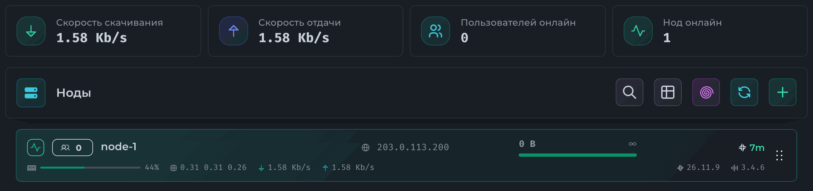

*Работающая нода в списке*

### 6.6. Хосты

Хост в панели говорит приложению, куда подключаться. Откройте «Подписка → Хосты» и нажмите зелёную кнопку «+» справа. Номера ниже совпадают с рамками на картинке.

1. Включите переключатель «Видимость хоста». Новый хост создаётся выключенным, и такой в подписку не попадает.
2. В «Примечании» напишите «Основной».
3. Нажмите на строку «Инбаунд не выбран», раскройте vpn, отметьте VLESS\_TCP и сохраните кнопкой с дискетой. Порт 443 подставится сам.
4. В поле «Адрес» впишите домен ноды, например n1.example.com.
5. В блоке «Опции» нажмите «Добавить», найдите «Отпечаток» и выберите в нём firefox. SNI добавлять не нужно, панель возьмёт его из профиля.

Сохраните хост кнопкой «Сохранить» внизу.

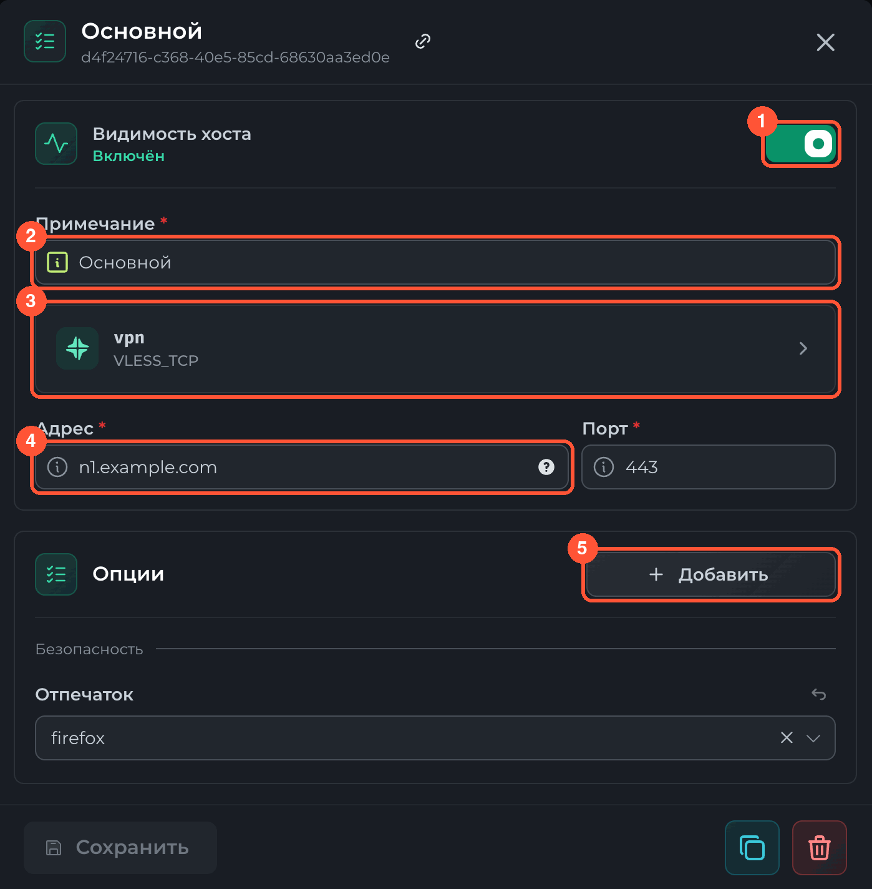

*Готовый хост «Основной»*

Второй хост сделайте так же, но с инбаундом VLESS\_XHTTP (порт 8444) и примечанием «Запасной». Через «Добавить» (1) поставьте ему отпечаток firefox (2) и ещё опцию «Доп. параметры XHTTP». Нажмите на кнопку рядом с ней (3), вставьте в открывшееся окно текст ниже и нажмите «Сохранить» в этом окне. Потом сохраните сам хост.

```json
{
  "xmux": {
    "maxConnections": 1,
    "cMaxReuseTimes": 0,
    "hMaxRequestTimes": "600-900",
    "hMaxReusableSecs": "1800-3000",
    "hKeepAlivePeriod": 30
  }
}
```

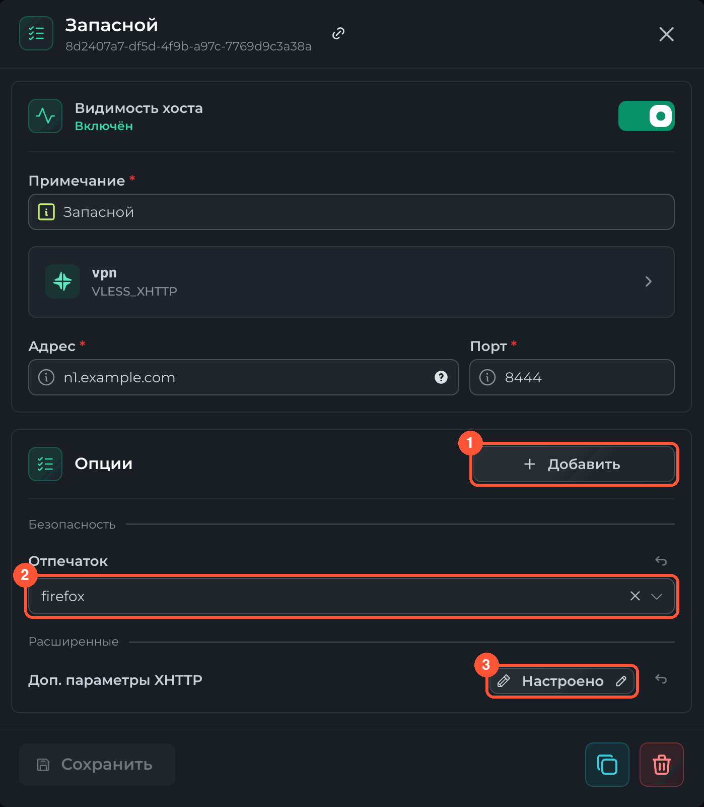

*Хост «Запасной» с двумя опциями*

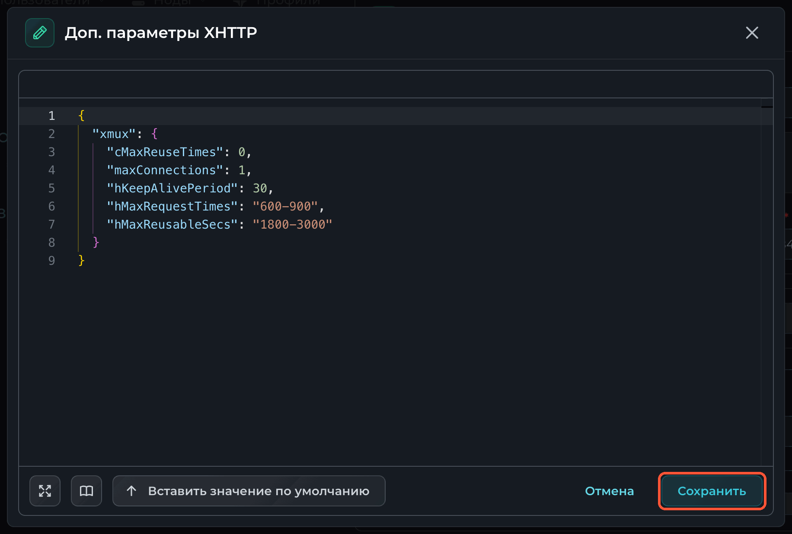

*Окно «Доп. параметры XHTTP» с вставленным текстом*

### 6.7. Сквад

Сквад определяет, какие инбаунды доступны пользователю. Откройте «Пользователи → Внутренние сквады» и нажмите на Default-Squad. Справа откроется список профилей. Нажмите галочку в строке vpn (1), чтобы отметить VLESS\_TCP и VLESS\_XHTTP, и сохраните кнопкой с дискетой вверху (2).

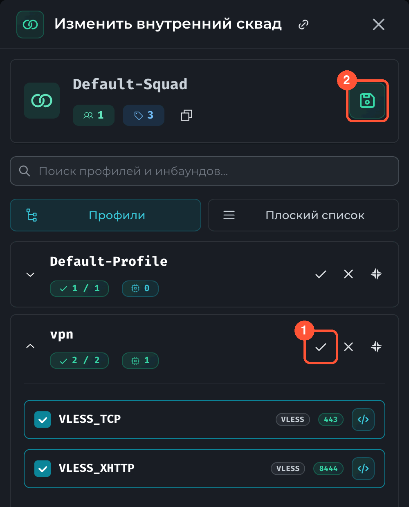

*Сквад Default-Squad с инбаундами vpn*

### 6.8. Пользователь

Откройте «Пользователи → Пользователи» и нажмите зелёную кнопку «+» справа. Юзернейм может быть любым, но латиницей и без пробелов, например myvpn (1). Лимит трафика оставьте 0, это значит без ограничений.

Дату окончания панель сама ставит на завтра, и через сутки VPN перестанет работать. Поэтому нажмите на поле «Дата окончания» (2).

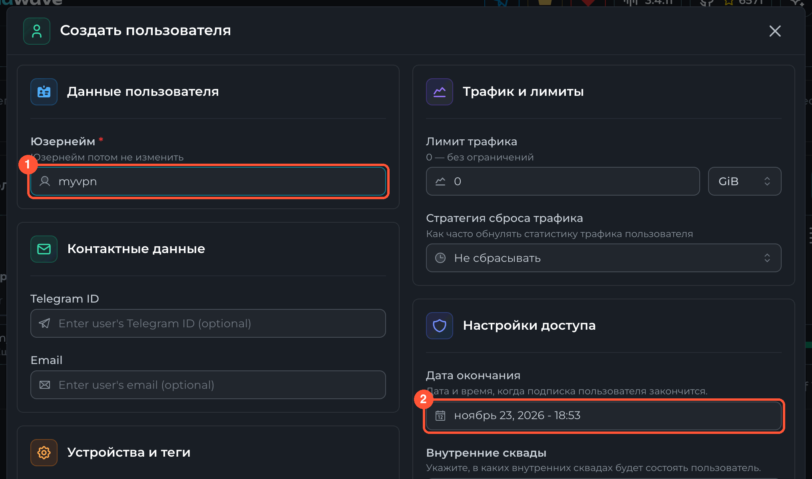

*Форма нового пользователя*

В календаре выберите «до 2099 года» (1) и подтвердите галочкой (2).

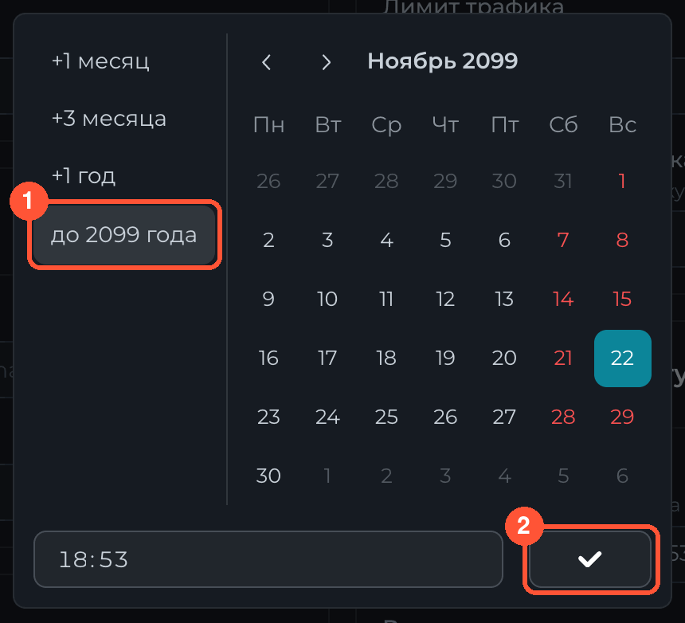

*Выбор даты окончания*

Ниже, в блоке «Внутренние сквады», отметьте Default-Squad (1) и нажмите «Создать» (2).

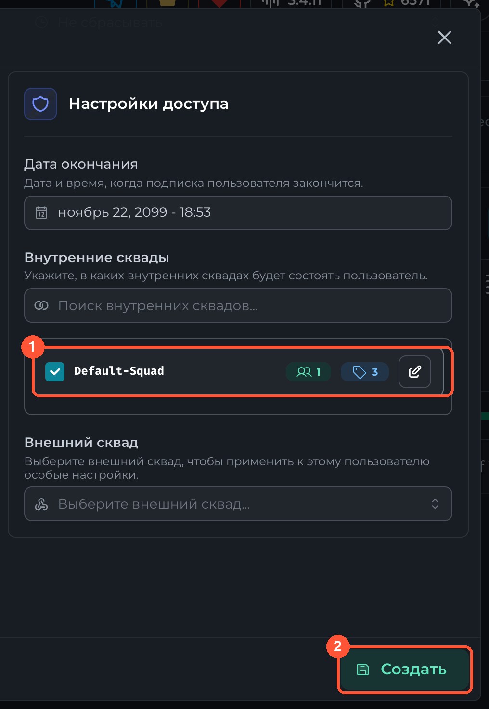

*Сквад пользователя и кнопка «Создать»*

## 7. Подключение

### 7.1. Где взять ссылку

Ссылка подписки и есть ваш ключ от VPN. Выглядит она примерно как https://adm-xxxx.example.com/api/sub/AbCd1234EfGh5678.

Если ставили скриптом, ссылка и QR-код появились в самом конце его работы. Показать их снова можно командой `bash install.sh info`.

Если ставили вручную, откройте в панели «Пользователи» и нажмите на имя пользователя. В его окне есть поле «Ссылка на подписку» с кнопкой копирования справа (1). QR-код открывается первой кнопкой в ряду значков (2).

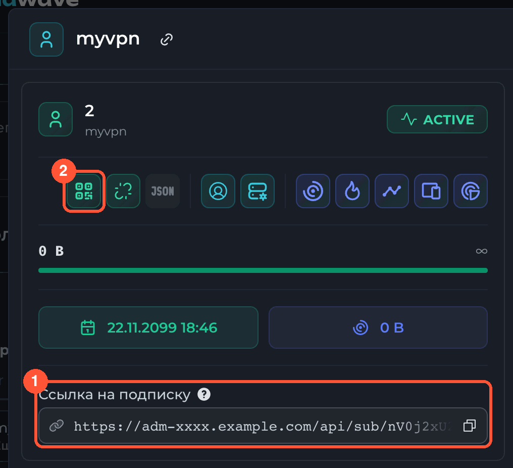

*Окно пользователя*

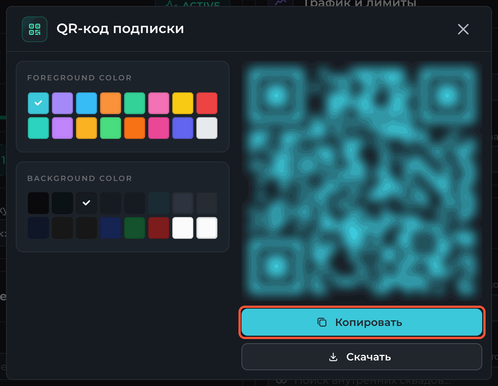

*QR-код подписки. На снимке он размыт, сканировать нужно свой*

Чтобы скопировать ссылку из терминала, выделите её мышью и нажмите Ctrl+C в Windows Terminal или Cmd+C в macOS. На телефон ссылку удобно переслать самому себе, например в «Избранное» в Telegram.

### 7.2. Телефон

1. Установите Happ или INCY. Ссылки на App Store и Google Play есть на сайтах приложений ([Happ](https://happ.info/), [INCY](https://incy.cc/#downloads)). Можно и просто найти их в магазине по названию.
2. Откройте приложение и нажмите «+». Обычно он вверху экрана.
3. Выберите сканирование QR-кода и наведите камеру на QR-код на экране компьютера. Если ссылка уже скопирована на телефоне, выберите вставку из буфера обмена.
4. В списке появятся «Основной» и «Запасной». Выберите «Основной» и нажмите кнопку включения.
5. При первом включении телефон спросит, можно ли добавить конфигурацию VPN. Разрешите. На iPhone это подтверждается код-паролем или Face ID.

### 7.3. Компьютер

1. Скачайте Happ или INCY для Windows или macOS с сайта приложения и установите.
2. Скопируйте ссылку подписки (раздел 7.1).
3. В приложении нажмите «+» и выберите вставку из буфера обмена.
4. Выберите «Основной» и включите VPN. Если система спросит разрешение, разрешите.

### 7.4. Проверка

Откройте сайт [ifconfig.me](https://ifconfig.me). Если VPN работает, там будет IP вашего сервера. Если там ваш обычный адрес, VPN не включён. Если «Основной» не подключается или тормозит, попробуйте «Запасной». Он держит всё подключение в одном соединении, и российские фильтры замораживают его реже.

## 8. Ещё пользователи

Если VPN нужен близким, создайте каждому своего пользователя. У каждого будет своя ссылка, и доступ можно будет отключить отдельно. Имя пишется латиницей, от 3 символов.

```bash
# на сервере, вместо mama впишите любое имя
bash install.sh add-user mama
```

Скрипт покажет ссылку и QR-код нового пользователя. Если ставили вручную, создайте пользователя в панели так же, как в разделе 6.8. Отключить или удалить пользователя, поставить лимит трафика или срок действия можно в панели, в разделе «Пользователи».

## 9. Панель

Панель открывается по адресу https://adm-xxxx.example.com (ваш адрес панели). Если ставили скриптом, логин и пароль он показал в конце. Пароль лучше не терять. Адрес панели можно найти в открытых журналах сертификатов, так что защищает её именно пароль. Если всё же потеряли, на сервере поможет команда `docker exec -it remnawave cli`.

Подробнее про разделы панели написано в [быстром старте Remnawave](https://docs.rw/learn/quick-start). Для личного VPN обычно хватает раздела «Пользователи».

## 10. Если не работает

1. Скрипт или блок команд написал «СТОП». Прочитайте сообщение. Чаще всего домен ещё не указывает на сервер. Проверьте A-записи, подождите 10–30 минут и запустите то же самое ещё раз.
2. Приложение не подключается. Попробуйте «Запасной». Проверьте в панели, что карточка ноды в разделе «Ноды» зелёная. На сервере командой `docker ps` проверьте, что запущены контейнеры remnanode, caddy и remnawave.
3. Выключите VPN и откройте в браузере адрес ноды, например https://n1.example.com. Должна открыться страница Welcome без предупреждений о сертификате. Если её нет, посмотрите логи Caddy командой `cd /opt/remnawave/caddy && docker compose logs --tail=50`.
4. При ручной установке проверьте настройки в панели. Оба инбаунда должны быть отмечены в ноде и в скваде Default-Squad, пользователь должен состоять в этом скваде. У обоих хостов должна быть включена видимость. Если нода не становится зелёной, выполните `ufw status` и проверьте, что порт 2222 открыт для 172.16.0.0/12.
5. Сбились часы на сервере. Выполните `timedatectl` и посмотрите строку System clock synchronized. В ней должно быть yes.

Логи ноды смотрят командой `cd /opt/remnanode && docker compose logs --tail=100`, логи панели командой `cd /opt/remnawave && docker compose logs --tail=100`.

## 11. Полезное

### 11.1. Российские сайты

Часть российских сайтов (банки, Госуслуги, некоторые магазины) не пускает зарубежные IP. Через VPN вы заходите на них с IP сервера, поэтому такие сайты проще открывать с выключенным VPN. Ещё удобнее настроить в приложении маршрутизацию, чтобы российские сайты шли напрямую, мимо VPN.

### 11.2. Обновления

Новые версии выходят часто. Список есть на GitHub у [панели](https://github.com/remnawave/backend/releases) и у [ноды](https://github.com/remnawave/node/releases). Раз в пару месяцев обновляйте обе программы. Первые две цифры версии у панели и ноды должны совпадать (например, 3.4 и 3.4), иначе панель отключит ноду. Если в описании релиза написано breaking changes, лучше подождать или спросить в [чате Remnawave](https://t.me/+c8wKd62eIAE4ZDdi). Новости проекта выходят в [Telegram-канале](https://t.me/remnawave).

```bash
# на сервере, впишите номера новых версий панели и ноды
PANEL_VERSION=3.4.11
NODE_VERSION=3.4.6
(
set -eo pipefail
cd /opt/remnawave
sed -i -E "s|image: *remnawave/backend:.*|image: remnawave/backend:$PANEL_VERSION|" docker-compose.yml
docker compose pull
docker compose up -d
cd /opt/remnanode
sed -i -E "s|image: *remnawave/node:.*|image: remnawave/node:$NODE_VERSION|" docker-compose.yml
docker compose pull
docker compose up -d
echo "ГОТОВО, панель $PANEL_VERSION, нода $NODE_VERSION"
)
```

## 12. Примеры конфигов

При любом способе установки получаются одинаковые настройки. В примерах ниже вместо ключей и доменов стоят заглушки.

### 12.1. Профиль ноды

Профиль хранится в панели, в разделе «Профили». В нём обычный вход (инбаунд) на порту 443 и запасной XHTTP на порту 8444. Посторонних REALITY отправляет на сайт-прикрытие (127.0.0.1:8443). Торренты и исходящая почта закрыты, локальные сети тоже.

```json
{
  "log": { "loglevel": "warning" },
  "inbounds": [
    {
      "tag": "VLESS_TCP",
      "port": 443,
      "listen": "0.0.0.0",
      "protocol": "vless",
      "settings": { "clients": [], "decryption": "none", "flow": "xtls-rprx-vision" },
      "sniffing": { "enabled": true, "routeOnly": true, "destOverride": ["http", "tls", "quic"] },
      "streamSettings": {
        "network": "raw",
        "security": "reality",
        "realitySettings": {
          "show": false,
          "xver": 0,
          "target": "127.0.0.1:8443",
          "serverNames": ["n1.example.com"],
          "privateKey": "ПРИВАТНЫЙ_КЛЮЧ",
          "shortIds": ["SHORT_ID"]
        }
      }
    },
    {
      "tag": "VLESS_XHTTP",
      "port": 8444,
      "listen": "0.0.0.0",
      "protocol": "vless",
      "settings": { "clients": [], "decryption": "none" },
      "sniffing": { "enabled": true, "routeOnly": true, "destOverride": ["http", "tls", "quic"] },
      "streamSettings": {
        "network": "xhttp",
        "xhttpSettings": { "host": "n1.example.com", "path": "/СЛУЧАЙНЫЙ_ПУТЬ", "mode": "stream-one" },
        "security": "reality",
        "realitySettings": {
          "show": false,
          "xver": 0,
          "target": "127.0.0.1:8443",
          "serverNames": ["n1.example.com"],
          "privateKey": "ПРИВАТНЫЙ_КЛЮЧ",
          "shortIds": ["SHORT_ID"]
        }
      }
    }
  ],
  "outbounds": [
    { "tag": "DIRECT", "protocol": "freedom" },
    { "tag": "BLOCK", "protocol": "blackhole" }
  ],
  "routing": {
    "rules": [
      { "ip": ["geoip:private"], "outboundTag": "BLOCK" },
      { "domain": ["geosite:private"], "outboundTag": "BLOCK" },
      { "protocol": ["bittorrent"], "outboundTag": "BLOCK" },
      { "network": "tcp", "port": "25,465,587", "outboundTag": "BLOCK" }
    ]
  }
}
```

### 12.2. Настройки запасного подключения

У хоста «Запасной» эта настройка лежит в опции «Доп. параметры XHTTP». С ней приложение держит всё подключение в одном соединении.

```json
{
  "xmux": {
    "maxConnections": 1,
    "cMaxReuseTimes": 0,
    "hMaxRequestTimes": "600-900",
    "hMaxReusableSecs": "1800-3000",
    "hKeepAlivePeriod": 30
  }
}
```

### 12.3. Нода

Файл /opt/remnanode/docker-compose.yml. SECRET\_KEY выдаёт панель, и по нему она узнаёт свою ноду. При ручной установке этот файл копируется из панели и может выглядеть чуть иначе.

```yaml
services:
  remnanode:
    container_name: remnanode
    hostname: remnanode
    image: remnawave/node:3.4.6
    network_mode: host
    restart: always
    cap_add:
      - NET_ADMIN
    ulimits:
      nofile:
        soft: 1048576
        hard: 1048576
    environment:
      NODE_PORT: "2222"
      SECRET_KEY: "КЛЮЧ_ИЗ_ПАНЕЛИ"
```

### 12.4. Caddy

Файл /opt/remnawave/caddy/Caddyfile. Порт 443 занимает нода, поэтому Caddy слушает только 127.0.0.1:8443. Обычные заходы на сайт нода передаёт ему, так что панель открывается по своему адресу, а на адресе ноды виден сайт-прикрытие.

```caddyfile
https://adm-xxxx.example.com {
    encode
    reverse_proxy * http://remnawave:3000
}
https://n1.example.com {
    header Content-Type "text/html; charset=utf-8"
    respond "<html><head><title>Welcome</title></head><body><h1>Welcome</h1></body></html>" 200
}
:443 {
    tls internal
    respond 204
}
```

### 12.5. Что внутри подписки

По ссылке подписки приложение получает два подключения такого вида.

```text
vless://UUID@n1.example.com:443?encryption=none&flow=xtls-rprx-vision&type=tcp&security=reality&sni=n1.example.com&fp=firefox&pbk=ПУБЛИЧНЫЙ_КЛЮЧ&sid=SHORT_ID#Основной
vless://UUID@n1.example.com:8444?encryption=none&type=xhttp&path=/СЛУЧАЙНЫЙ_ПУТЬ&host=n1.example.com&mode=stream-one&security=reality&sni=n1.example.com&fp=firefox&pbk=ПУБЛИЧНЫЙ_КЛЮЧ&sid=SHORT_ID#Запасной
```

Настройки панели лежат в /opt/remnawave/.env, а её запуск описан в /opt/remnawave/docker-compose.yml. Скрипт хранит свои служебные данные в /root/remnawave-vpn.env. Профиль при ручной установке сохраняется в /root/remnawave-profile.json.

## 13. Ссылки

Документация Remnawave находится на [docs.rw](https://docs.rw), там же есть [быстрый старт на русском](https://docs.rw/learn/quick-start). Код проекта лежит на [GitHub](https://github.com/remnawave). Панель и нода живут в отдельных репозиториях [backend](https://github.com/remnawave/backend) и [node](https://github.com/remnawave/node). Новости выходят в [Telegram-канале](https://t.me/remnawave), а вопросы можно задать в [чате](https://t.me/+c8wKd62eIAE4ZDdi).

Приложения скачиваются с сайтов [Happ](https://happ.info/) и [INCY](https://incy.cc/#downloads).

Серверы можно взять у [Netcup](https://www.netcup.com), [Hetzner](https://www.hetzner.com/cloud), [DigitalOcean](https://www.digitalocean.com), [Cherry Servers](https://www.cherryservers.com) или [V.PS](https://v.ps). Домен можно купить у [NameSilo](https://www.namesilo.com), а DNS держать в [Cloudflare](https://www.cloudflare.com).

Ядро VPN называется Xray. Его код лежит в репозитории [XTLS/Xray-core](https://github.com/XTLS/Xray-core). Про блокировки VPN в России есть [разбор на Хабре](https://habr.com/ru/articles/1047442/).

## 14. Текст скрипта install.sh

Этот же текст лежит в файле install.sh рядом с гайдом. Копировать его удобнее из HTML-версии, кнопкой «Копировать».

```bash
#!/usr/bin/env bash

set -Eeuo pipefail

PANEL_VERSION="3.4.11"
NODE_VERSION="3.4.6"

STATE="${STATE:-/root/remnawave-vpn.env}"
SUMMARY="${SUMMARY:-/root/remnawave-vpn.txt}"
RW_DIR="${RW_DIR:-/opt/remnawave}"
NODE_DIR="${NODE_DIR:-/opt/remnanode}"
NET="${NET:-remnawave-network}"
API="${API:-http://127.0.0.1:3000/api}"
COMPOSE_URL="https://raw.githubusercontent.com/remnawave/backend/refs/heads/main/docker-compose-prod.yml"
ENV_URL="https://raw.githubusercontent.com/remnawave/backend/refs/heads/main/.env.sample"

say() { printf '\n\033[1;36m==> %s\033[0m\n' "$*"; }
die() { printf '\n\033[1;31mСТОП: %s\033[0m\n' "$*" >&2; exit 1; }
trap 'printf "\n\033[1;31mСТОП: упало на строке %s. Поправьте и запустите скрипт ещё раз\033[0m\n" "$LINENO" >&2' ERR

load_state() { if [ -f "$STATE" ]; then . "$STATE"; fi; }

save() {
  touch "$STATE"
  { grep -v "^$1=" "$STATE" || true; printf "%s='%s'\n" "$1" "$2"; } > "$STATE.tmp"
  mv "$STATE.tmp" "$STATE"
  chmod 600 "$STATE"
  printf -v "$1" '%s' "$2"
}

# без этих заголовков панель не отвечает на запросы мимо caddy
api() {
  local args=(-sS -X "$1" -H 'content-type: application/json' -H 'x-forwarded-for: 127.0.0.1'
              -H 'x-forwarded-proto: https' -H 'x-remnawave-client-type: browser')
  if [ -n "${TOKEN:-}" ]; then args+=(-H "authorization: Bearer $TOKEN"); fi
  if [ -n "${3:-}" ]; then args+=(-d "$3"); fi
  RESP=$(curl "${args[@]}" "$API$2") || die "панель не отвечает ($1 $2)"
  if ! jq -e '.response' >/dev/null 2>&1 <<<"$RESP"; then
    die "панель вернула ошибку на $1 $2. $(jq -c '.message // .' <<<"$RESP" 2>/dev/null || echo "$RESP")"
  fi
}

clean_domain() {
  local d
  d=$(printf '%s' "$1" | tr -d '[:space:]' | tr '[:upper:]' '[:lower:]')
  d=${d#https://}; d=${d#http://}; d=${d%%/*}
  printf '%s' "$d"
}

ask_domains() {
  if [ -z "${PANEL_DOMAIN:-}" ]; then
    read -rp "Домен панели, например adm-k3x9.example.com > " PANEL_DOMAIN </dev/tty
  fi
  if [ -z "${NODE_DOMAIN:-}" ]; then
    read -rp "Домен ноды, например n1.example.com > " NODE_DOMAIN </dev/tty
  fi
  PANEL_DOMAIN=$(clean_domain "$PANEL_DOMAIN")
  NODE_DOMAIN=$(clean_domain "$NODE_DOMAIN")
  local re='^[a-z0-9]([a-z0-9-]*[a-z0-9])?(\.[a-z0-9]([a-z0-9-]*[a-z0-9])?)+$'
  [[ $PANEL_DOMAIN =~ $re ]] || die "домен панели указан неверно (${PANEL_DOMAIN:-пусто})"
  [[ $NODE_DOMAIN =~ $re ]] || die "домен ноды указан неверно (${NODE_DOMAIN:-пусто})"
  [ "$PANEL_DOMAIN" != "$NODE_DOMAIN" ] || die "у панели и ноды должны быть разные домены"
  case "$PANEL_DOMAIN $NODE_DOMAIN" in *example.com*) die "впишите свои домены вместо example.com";; esac
  save PANEL_DOMAIN "$PANEL_DOMAIN"
  save NODE_DOMAIN "$NODE_DOMAIN"
}

check_dns() {
  say "Проверяю, что домены смотрят на этот сервер"
  local d ip
  for d in "$PANEL_DOMAIN" "$NODE_DOMAIN"; do
    ip=$(getent ahostsv4 "$d" | awk 'NR==1{print $1}') || true
    if [ -z "$ip" ] || ! hostname -I | grep -qw "$ip"; then
      die "$d пока не указывает на этот сервер (сейчас ${ip:-записи нет}). Проверьте A-запись и запустите скрипт минут через 10"
    fi
  done
}

install_base() {
  say "Обновляю систему и ставлю Docker, это 5-10 минут"
  export DEBIAN_FRONTEND=noninteractive NEEDRESTART_MODE=a
  apt-get update -q
  apt-get -y -q -o Dpkg::Options::=--force-confdef -o Dpkg::Options::=--force-confold upgrade
  apt-get -y -q install curl openssl ufw fail2ban jq qrencode

  if [ -s /root/.ssh/authorized_keys ]; then
    cat > /etc/ssh/sshd_config.d/00-hardening.conf <<'EOF'
PasswordAuthentication no
KbdInteractiveAuthentication no
PermitRootLogin prohibit-password
EOF
    sshd -t
    systemctl reload ssh
  fi

  cat > /etc/fail2ban/jail.local <<'EOF'
[sshd]
enabled = true
backend = systemd
maxretry = 5
findtime = 10m
bantime = 1h
EOF
  systemctl enable fail2ban >/dev/null 2>&1
  systemctl restart fail2ban

  # чтобы логи докера не съели диск
  mkdir -p /etc/docker
  if [ ! -f /etc/docker/daemon.json ]; then
    echo '{"log-driver":"json-file","log-opts":{"max-size":"50m","max-file":"3"}}' > /etc/docker/daemon.json
  fi
  if ! command -v docker >/dev/null; then curl -fsSL https://get.docker.com | sh; fi

  # bbr заметно помогает на дальних маршрутах
  echo tcp_bbr > /etc/modules-load.d/bbr.conf
  modprobe tcp_bbr || true
  cat > /etc/sysctl.d/99-zz-vpn.conf <<'EOF'
net.core.default_qdisc = fq
net.ipv4.tcp_congestion_control = bbr
net.ipv4.tcp_mtu_probing = 1
net.core.rmem_max = 67108864
net.core.wmem_max = 67108864
net.ipv4.tcp_rmem = 4096 131072 67108864
net.ipv4.tcp_wmem = 4096 16384 67108864
net.ipv4.tcp_slow_start_after_idle = 0
net.ipv4.tcp_notsent_lowat = 16384
EOF
  sysctl --system >/dev/null
  # reality не любит, когда часы на сервере врут
  timedatectl set-ntp true >/dev/null 2>&1 || true
}

install_panel() {
  say "Ставлю панель Remnawave $PANEL_VERSION и Caddy"
  mkdir -p "$RW_DIR/caddy"
  cd "$RW_DIR"
  curl -fsSL -o docker-compose.yml "$COMPOSE_URL"
  sed -i "s|image: remnawave/backend:.*|image: remnawave/backend:$PANEL_VERSION|" docker-compose.yml

  # .env только при первом запуске, база уже создана со старым паролем
  if [ ! -f .env ]; then
    curl -fsSL -o .env "$ENV_URL"
    local pw
    pw=$(openssl rand -hex 24)
    sed -i "s/^APP_SECRET=.*/APP_SECRET=$(openssl rand -hex 64)/" .env
    sed -i "s/^METRICS_PASS=.*/METRICS_PASS=$(openssl rand -hex 64)/" .env
    sed -i "s/^WEBHOOK_SECRET_HEADER=.*/WEBHOOK_SECRET_HEADER=$(openssl rand -hex 32)/" .env
    sed -i "s/^POSTGRES_PASSWORD=.*/POSTGRES_PASSWORD=$pw/" .env
    sed -i "s|^\(DATABASE_URL=\"postgresql://postgres:\)[^\@]*\(@.*\)|\1$pw\2|" .env
  fi
  sed -i "s|^PANEL_DOMAIN=.*|PANEL_DOMAIN=$PANEL_DOMAIN|; s|^FRONT_END_DOMAIN=.*|FRONT_END_DOMAIN=$PANEL_DOMAIN|; s|^SUB_PUBLIC_DOMAIN=.*|SUB_PUBLIC_DOMAIN=$PANEL_DOMAIN/api/sub|" .env

  # 443 занимает нода, обычных посетителей она отправляет сюда на 8443
  cat > caddy/Caddyfile <<EOF
https://$PANEL_DOMAIN {
    encode
    reverse_proxy * http://remnawave:3000
}
https://$NODE_DOMAIN {
    header Content-Type "text/html; charset=utf-8"
    respond "<html><head><title>Welcome</title></head><body><h1>Welcome</h1></body></html>" 200
}
:443 {
    tls internal
    respond 204
}
EOF
  cat > caddy/docker-compose.yml <<'EOF'
services:
  caddy:
    image: caddy:2.9
    container_name: caddy
    hostname: caddy
    restart: always
    ports:
      - '127.0.0.1:8443:443'
      - '0.0.0.0:80:80'
    networks:
      - remnawave-network
    volumes:
      - ./Caddyfile:/etc/caddy/Caddyfile
      - caddy-ssl-data:/data
networks:
  remnawave-network:
    name: remnawave-network
    external: true
volumes:
  caddy-ssl-data:
    name: caddy-ssl-data
EOF

  docker compose up -d
  (cd caddy && docker compose up -d --force-recreate)
}

wait_panel() {
  say "Жду, пока панель запустится"
  local i
  for i in $(seq 1 60); do
    if [ "$(docker inspect -f '{{.State.Health.Status}}' remnawave 2>/dev/null)" = healthy ]; then return; fi
    sleep 5
  done
  die "панель не поднялась за 5 минут, смотрите логи (cd $RW_DIR && docker compose logs --tail=50)"
}

setup_firewall() {
  say "Настраиваю фаервол"
  local subnet ssh_port
  # 2222 нужен только панели из докер-сети
  subnet=$(docker network inspect "$NET" -f '{{(index .IPAM.Config 0).Subnet}}')
  # вдруг ssh у хостера не на 22
  ssh_port=$(sshd -T 2>/dev/null | awk '$1=="port"{print $2; exit}') || true
  ufw allow "${ssh_port:-22}"/tcp >/dev/null
  ufw allow 80/tcp >/dev/null
  ufw allow 443/tcp >/dev/null
  ufw allow 8444/tcp >/dev/null
  ufw allow from "$subnet" to any port 2222 proto tcp >/dev/null
  ufw --force enable >/dev/null
}

panel_login() {
  TOKEN=""
  api GET /auth/status
  if [ "$(jq -r '.response.isRegisterAllowed' <<<"$RESP")" = true ]; then
    say "Создаю администратора панели"
    [ -n "${ADMIN_USER:-}" ] || save ADMIN_USER "admin"
    # панель требует пароль от 24 символов
    [ -n "${ADMIN_PASS:-}" ] || save ADMIN_PASS "Vpn$(openssl rand -hex 14)X9"
    api POST /auth/register "$(jq -nc --arg u "$ADMIN_USER" --arg p "$ADMIN_PASS" '{username:$u,password:$p}')"
  else
    [ -n "${ADMIN_PASS:-}" ] || die "в панели уже есть администратор, а пароля от него в $STATE нет"
    api POST /auth/login "$(jq -nc --arg u "$ADMIN_USER" --arg p "$ADMIN_PASS" '{username:$u,password:$p}')"
  fi
  TOKEN=$(jq -r '.response.accessToken' <<<"$RESP")
}

create_profile() {
  if [ -n "${PROFILE_UUID:-}" ]; then return; fi
  say "Делаю ключи REALITY и профиль ноды"
  local keys priv sid xpath
  keys=$(docker run --rm ghcr.io/xtls/xray-core x25519)
  priv=$(awk -F': ' 'tolower($1) ~ /private/ {print $2}' <<<"$keys")
  [ -n "$priv" ] || die "не получилось сделать ключ REALITY"
  sid=$(openssl rand -hex 8)
  xpath="/$(openssl rand -hex 6)"
  api POST /config-profiles "$(jq -nc --arg dom "$NODE_DOMAIN" --arg priv "$priv" --arg sid "$sid" --arg xp "$xpath" '
    ({show:false, xver:0, target:"127.0.0.1:8443", serverNames:[$dom], privateKey:$priv, shortIds:[$sid]}) as $reality
    | ({enabled:true, routeOnly:true, destOverride:["http","tls","quic"]}) as $sniff
    | {name:"vpn", config:{
        log:{loglevel:"warning"},
        inbounds:[
          {tag:"VLESS_TCP", port:443, listen:"0.0.0.0", protocol:"vless",
           settings:{clients:[], decryption:"none", flow:"xtls-rprx-vision"}, sniffing:$sniff,
           streamSettings:{network:"raw", security:"reality", realitySettings:$reality}},
          {tag:"VLESS_XHTTP", port:8444, listen:"0.0.0.0", protocol:"vless",
           settings:{clients:[], decryption:"none"}, sniffing:$sniff,
           streamSettings:{network:"xhttp", xhttpSettings:{host:$dom, path:$xp, mode:"stream-one"},
                           security:"reality", realitySettings:$reality}}],
        outbounds:[{tag:"DIRECT", protocol:"freedom"}, {tag:"BLOCK", protocol:"blackhole"}],
        routing:{rules:[
          {ip:["geoip:private"], outboundTag:"BLOCK"},
          {domain:["geosite:private"], outboundTag:"BLOCK"},
          {protocol:["bittorrent"], outboundTag:"BLOCK"},
          {network:"tcp", port:"25,465,587", outboundTag:"BLOCK"}]}}}')"
  save IN_TCP "$(jq -r '.response.inbounds[] | select(.tag=="VLESS_TCP") | .uuid' <<<"$RESP")"
  save IN_XH "$(jq -r '.response.inbounds[] | select(.tag=="VLESS_XHTTP") | .uuid' <<<"$RESP")"
  save PROFILE_UUID "$(jq -r '.response.uuid' <<<"$RESP")"
  docker rmi ghcr.io/xtls/xray-core >/dev/null 2>&1 || true
}

create_node() {
  if [ -n "${NODE_UUID:-}" ]; then return; fi
  say "Добавляю ноду в панель"
  local gw
  # нода на этом же сервере, панель ходит к ней через шлюз докер-сети
  gw=$(docker network inspect "$NET" -f '{{(index .IPAM.Config 0).Gateway}}')
  api POST /nodes "$(jq -nc --arg a "$gw" --arg p "$PROFILE_UUID" --arg t "$IN_TCP" --arg x "$IN_XH" \
    '{name:"node-1", address:$a, port:2222, configProfile:{activeConfigProfileUuid:$p, activeInbounds:[$t,$x]}}')"
  save NODE_UUID "$(jq -r '.response.uuid' <<<"$RESP")"
}

start_node() {
  say "Запускаю ноду Remnawave $NODE_VERSION"
  mkdir -p "$NODE_DIR"
  if [ ! -f "$NODE_DIR/docker-compose.yml" ]; then
    local key
    api GET /keygen
    key=$(jq -r '.response.secretKey // .response.payload // .response.pubKey' <<<"$RESP")
    (umask 077; cat > "$NODE_DIR/docker-compose.yml" <<EOF
services:
  remnanode:
    container_name: remnanode
    hostname: remnanode
    image: remnawave/node:$NODE_VERSION
    network_mode: host
    restart: always
    cap_add:
      - NET_ADMIN
    ulimits:
      nofile:
        soft: 1048576
        hard: 1048576
    environment:
      NODE_PORT: "2222"
      SECRET_KEY: "$key"
EOF
    )
  fi
  (cd "$NODE_DIR" && docker compose up -d)
  local i
  for i in $(seq 1 36); do
    api GET "/nodes/$NODE_UUID"
    if [ "$(jq -r '.response.isConnected' <<<"$RESP")" = true ]; then return; fi
    sleep 5
  done
  die "нода не подключилась к панели за 3 минуты, смотрите логи (cd $NODE_DIR && docker compose logs --tail=50)"
}

create_hosts() {
  if [ -n "${HOSTS_DONE:-}" ]; then return; fi
  say "Создаю подключения Основной и Запасной"
  api POST /hosts "$(jq -nc --arg p "$PROFILE_UUID" --arg i "$IN_TCP" --arg a "$NODE_DOMAIN" \
    '{inbound:{configProfileUuid:$p, configProfileInboundUuid:$i}, remark:"Основной", address:$a, port:443, fingerprint:"firefox"}')"
  api POST /hosts "$(jq -nc --arg p "$PROFILE_UUID" --arg i "$IN_XH" --arg a "$NODE_DOMAIN" \
    '{inbound:{configProfileUuid:$p, configProfileInboundUuid:$i}, remark:"Запасной", address:$a, port:8444, fingerprint:"firefox"}')"
  # xmux держит всё в одном соединении, такое тспу морозит реже
  api PATCH /hosts "$(jq -nc --arg u "$(jq -r '.response.uuid' <<<"$RESP")" \
    '{uuid:$u, xhttpExtraParams:{xmux:{maxConnections:1, cMaxReuseTimes:0, hMaxRequestTimes:"600-900", hMaxReusableSecs:"1800-3000", hKeepAlivePeriod:30}}}')"
  save HOSTS_DONE 1
}

setup_squad() {
  api GET /internal-squads
  save SQUAD_UUID "$(jq -r '([.response.internalSquads[] | select(.name=="Default-Squad")][0] // .response.internalSquads[0]).uuid' <<<"$RESP")"
  api PATCH /internal-squads "$(jq -nc --arg u "$SQUAD_UUID" --arg t "$IN_TCP" --arg x "$IN_XH" '{uuid:$u, inbounds:[$t,$x]}')"
}

create_user() {
  [[ $1 =~ ^[A-Za-z0-9_-]{3,36}$ ]] || die "имя пользователя нужно латиницей, от 3 до 36 символов (буквы, цифры, _ и -)"
  local exp
  exp="$(( $(date -u +%Y) + 10 ))-01-01T00:00:00.000Z"
  api POST /users "$(jq -nc --arg n "$1" --arg e "$exp" --arg s "$SQUAD_UUID" '{username:$n, expireAt:$e, activeInternalSquads:[$s]}')"
  SUB=$(jq -r '.response.subscriptionUrl' <<<"$RESP")
}

show_link() {
  printf '\nСсылка подписки для %s\n%s\n\n' "$1" "$2"
  if command -v qrencode >/dev/null; then qrencode -t ansiutf8 -m 1 "$2"; fi
}

do_install() {
  [ -r /etc/os-release ] && . /etc/os-release
  [ "${ID:-}" = ubuntu ] || die "скрипт рассчитан на Ubuntu 24.04"
  load_state
  ask_domains
  check_dns
  install_base
  install_panel
  wait_panel
  setup_firewall
  panel_login
  create_profile
  create_node
  start_node
  create_hosts
  setup_squad
  if [ -z "${MAIN_SUB:-}" ]; then
    create_user myvpn
    save MAIN_SUB "$SUB"
  fi
  {
    echo "Панель https://$PANEL_DOMAIN"
    echo "Логин $ADMIN_USER"
    echo "Пароль $ADMIN_PASS"
    echo "Подписка myvpn $MAIN_SUB"
  } > "$SUMMARY"
  chmod 600 "$SUMMARY"
  do_info
  printf '\n\033[1;32mГОТОВО. Всё это лежит в %s\033[0m\n' "$SUMMARY"
}

do_info() {
  load_state
  [ -n "${MAIN_SUB:-}" ] || die "установка ещё не закончена, сначала запустите bash install.sh"
  printf '\nПанель   https://%s\nЛогин    %s\nПароль   %s\n' "$PANEL_DOMAIN" "$ADMIN_USER" "$ADMIN_PASS"
  show_link "myvpn" "$MAIN_SUB"
}

do_add_user() {
  [ -n "${1:-}" ] || die "укажите имя, например bash install.sh add-user mama"
  load_state
  [ -n "${SQUAD_UUID:-}" ] || die "установка ещё не закончена, сначала запустите bash install.sh"
  panel_login
  create_user "$1"
  echo "Подписка $1 $SUB" >> "$SUMMARY"
  show_link "$1" "$SUB"
  printf '\n\033[1;32mГОТОВО, пользователь %s создан\033[0m\n' "$1"
}

main() {
  [ "$(id -u)" -eq 0 ] || die "запустите скрипт от root"
  case "${1:-install}" in
    install) do_install ;;
    add-user) do_add_user "${2:-}" ;;
    info) do_info ;;
    *) die "не знаю команду $1, есть install, add-user и info" ;;
  esac
}

if [ "${BASH_SOURCE[0]}" = "$0" ]; then main "$@"; fi
```

---

Личный VPN на Remnawave, ноябрь 2026.
